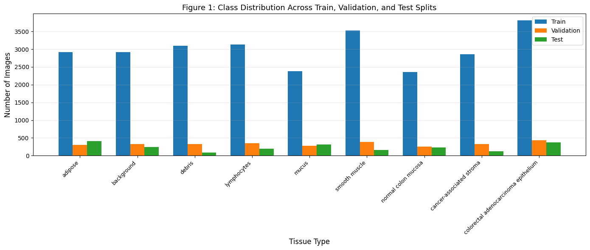
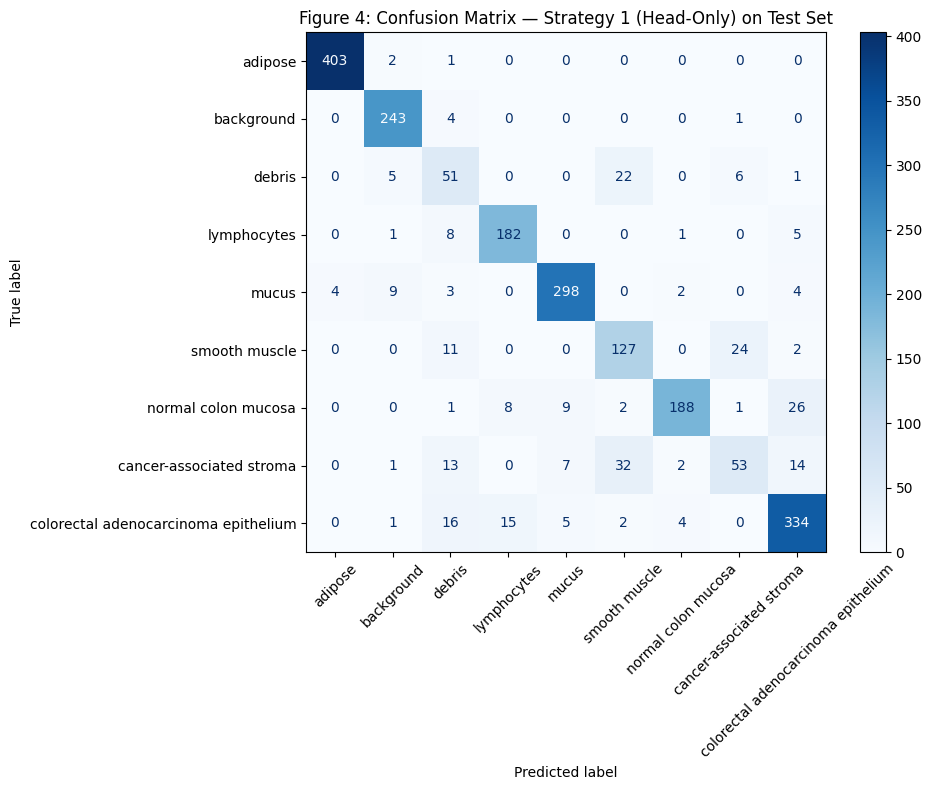

# Fine-Tuning a Vision Transformer for Histopathology Tissue Classification

Adapting a pretrained vision transformer (DeiT-tiny) to classify colorectal H&E tissue patches into 9 tissue types, and measuring how much of the encoder actually needs retraining.

**Stack:** Python, PyTorch, Hugging Face Transformers, scikit-learn, matplotlib, seaborn

![t-SNE of [CLS] embeddings, head-only vs partial unfreeze](figures/fig_08.png)

---

## The question
A pretrained model can be adapted cheaply (train only a new classification head) or more expensively (also retrain part of the encoder). Which is worth it for pathology images, and why?

## Data
[PathMNIST](https://medmnist.com/) from MedMNIST: H&E stained colorectal tissue patches in 9 classes (adipose, background, debris, lymphocytes, mucus, smooth muscle, normal colon mucosa, cancer-associated stroma, colorectal adenocarcinoma epithelium). Images are resized to 224 × 224 for the transformer.



## Approach
| Strategy | What is trained | Trainable parameters |
|---|---|---|
| 1. Head only | New classifier head, all 12 encoder layers frozen | ~1.7K |
| 2. Partial unfreeze | Last 2 of 12 encoder layers plus head, lower learning rate | 891,465 of 5,526,153 (16.1%) |

- Model: `facebook/deit-tiny-patch16-224`
- Learning rate for Strategy 2 chosen from 1e-5, 2e-5 and 5e-5 on the validation set only; the test set was held out until final scoring
- Macro F1 reported alongside accuracy because classes are imbalanced
- Representation quality checked with PCA and t-SNE of the 192-dimensional [CLS] embeddings, then k-means (k = 9) scored with ARI and NMI
- Fixed seeds for reproducibility

## Results

**Fine-tuning strategies**

| Strategy | Val accuracy | Val macro F1 | Test accuracy | Test macro F1 |
|---|---|---|---|---|
| 1: Head only | 0.884 | 0.885 | 0.872 | 0.811 |
| 2: Encoder + head | 0.934 | 0.935 | 0.904 | **0.861** |

**Embedding cluster quality (k-means, k = 9)**

| Strategy | ARI | NMI |
|---|---|---|
| 1: Head only | 0.424 | 0.548 |
| 2: Encoder + head | **0.875** | **0.850** |

- The biggest gains came in the hardest classes: debris improved by about 20 F1 points and cancer-associated stroma by about 8.
- Unfreezing the last two layers reorganised the embedding space so tissue types separate cleanly (ARI 0.42 to 0.88), which explains the classification gain rather than just reporting it.
- Trade-off: the better model needed a learning-rate search and about 50% more training time.

| Head only | Encoder + head |
|---|---|
|  |  |

## Repository structure
```
notebooks/vit_pathmnist_fine_tuning.ipynb   full pipeline with outputs
figures/                                     figures exported from the notebook
requirements.txt
```

## How to run
```bash
pip install -r requirements.txt
jupyter notebook notebooks/vit_pathmnist_fine_tuning.ipynb
```
A GPU is recommended. The dataset downloads through the `medmnist` package.

## Data credit
Yang J. et al. *MedMNIST v2: A large-scale lightweight benchmark for 2D and 3D biomedical image classification.* Scientific Data, 2023. Derived from Kather J.N. et al., NCT-CRC-HE-100K.

## Author
**Judah Akinlaja**, Health Data Scientist
[LinkedIn](https://www.linkedin.com/in/judah-akinlaja-a10385194) · [Portfolio](https://judahakinlajar.co.uk) · [GitHub](https://github.com/Akinlajar)
